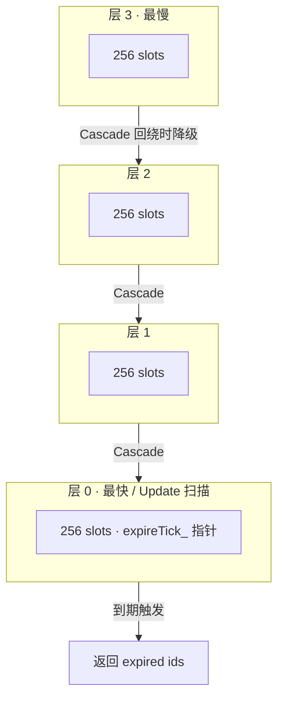

# WheelTimer
C++ Hashed Hierarchical Wheel Timer, inspired by [Folly HHWheelTimer](https://github.com/facebook/folly/blob/main/folly/io/async/HHWheelTimer.h).
header only, no dependencies.

## 算法演示 / Algorithm Demo

交互式可视化（教学尺寸 4 层 × 8 槽），**点开即可操作**：

**[▶ 在线算法演示](https://esrrhs.github.io/wheel_timer/)**

（同源文件也可本地打开 [`docs/wheel_timer_demo.html`](docs/wheel_timer_demo.html)，单文件、无构建、无外部依赖。）

演示覆盖与 `wheel_timer.h` 一致的四类操作：

- **插入 Insert（Add / AddImpl）**：`delay_ms` → `end_tick`，按 `diff = end_tick - expireTick_` 落入层 0..3，槽位由 `end_tick` 右移后取 mask；并写入 `timer_map_`。
- **触发 Trigger（Update）**：推进 `expireTick_`，弹出层 0 当前槽内到期定时器。
- **轮转 Cascade（CascadeTimers）**：层 0 指针回绕（`idx == 0`）时，从高层对应槽取出定时器并重新 `AddImpl` 降级。
- **删除 Delete（Del）**：按 id 在 `timer_map_` 定位，从 bucket 向量 swap-remove 后擦除 map。

> 真实参数：`WHEEL_BUCKETS = 4`，`WHEEL_BITS = 8`（每层 256 槽），`DEFAULT_TICK_INTERVAL = 10ms`。演示页使用缩小的 8 槽以便看清级联，数学与源码一致。



## Usage
```cpp
WheelTimer t;

// add two timer with 1000ms
auto t1 = t.Add(1000);
auto t2 = t.Add(1000);

// delete the second timer
t.Del(t2); 

// wait for 1000ms; tick granularity is 10ms
std::this_thread::sleep_for(std::chrono::milliseconds(1000));

// update the timer, return the expired timers t1
auto ret = t.Update();
```

## Build
```bash
mkdir build
cd build
cmake ..
make
```
