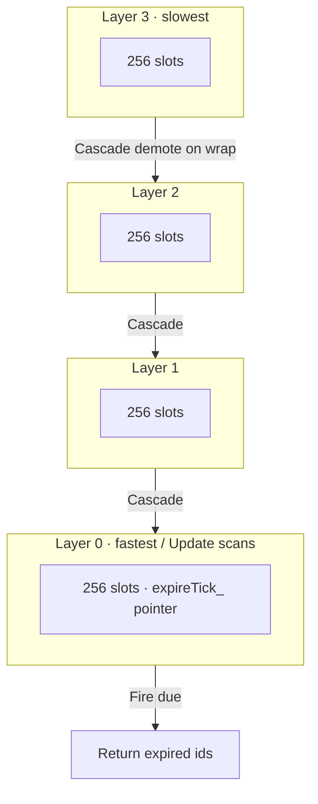

# WheelTimer

English | [中文](README_zh.md)

C++ Hashed Hierarchical Wheel Timer, inspired by [Folly HHWheelTimer](https://github.com/facebook/folly/blob/main/folly/io/async/HHWheelTimer.h).
Header only, no dependencies.

## Algorithm Demo

Interactive visualization (teaching size: 4 layers × 8 slots). Open and try it:

**[▶ Live algorithm demo](https://esrrhs.github.io/wheel_timer/)**

(Same file can also be opened locally: [`docs/wheel_timer_demo.html`](docs/wheel_timer_demo.html) — single file, no build, no external deps.)

The demo covers the four operations that match `wheel_timer.h`:

- **Insert (Add / AddImpl)**: `delay_ms` → `end_tick`; place by `diff = end_tick - expireTick_` into layer 0..3; slot from `end_tick` after right-shift and mask; also write `timer_map_`.
- **Trigger (Update)**: advance `expireTick_`, pop timers due in the current layer-0 slot.
- **Cascade (CascadeTimers)**: when the layer-0 pointer wraps (`idx == 0`), take timers from the matching higher-layer slot and re-`AddImpl` them (demote).
- **Delete (Del)**: look up by id in `timer_map_`, swap-remove from the bucket vector, then erase the map entry.

> Production parameters: `WHEEL_BUCKETS = 4`, `WHEEL_BITS = 8` (256 slots per layer), `DEFAULT_TICK_INTERVAL = 10ms`. The demo uses a shrunk 8-slot wheel so cascades are easy to see; the math matches the source.



## Usage
```cpp
WheelTimer t;

// add two timer with 1000ms
auto t1 = t.Add(1000);
auto t2 = t.Add(1000);

// delete the second timer
t.Del(t2); 

// wait for 1000ms; tick granularity is 10ms
std::this_thread::sleep_for(std::chrono::milliseconds(1000));

// update the timer, return the expired timers t1
auto ret = t.Update();
```

## Build
```bash
mkdir build
cd build
cmake ..
make
```
